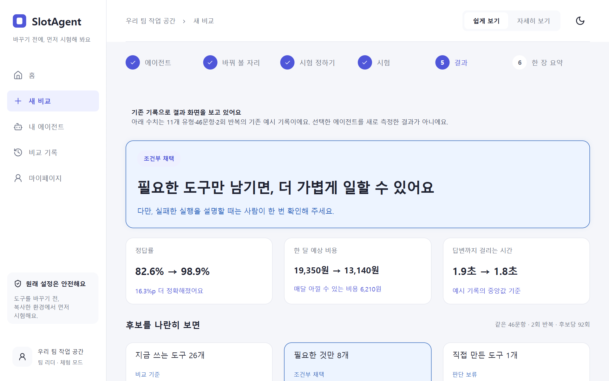
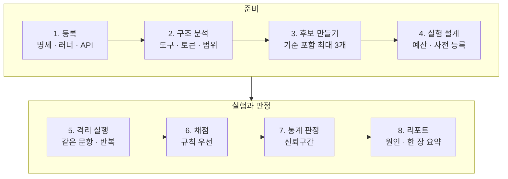
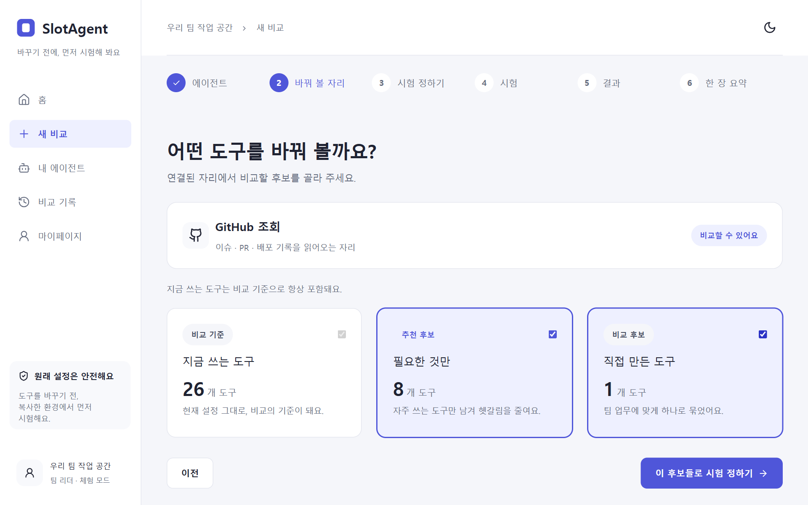
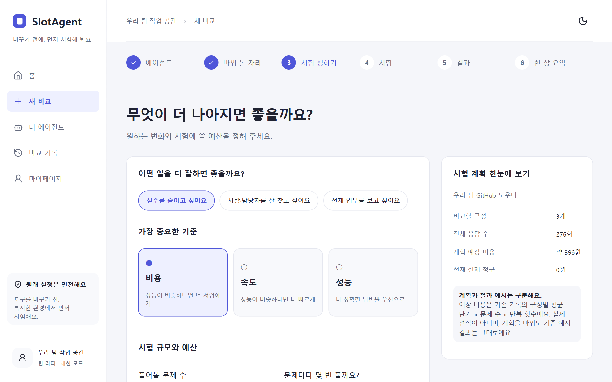
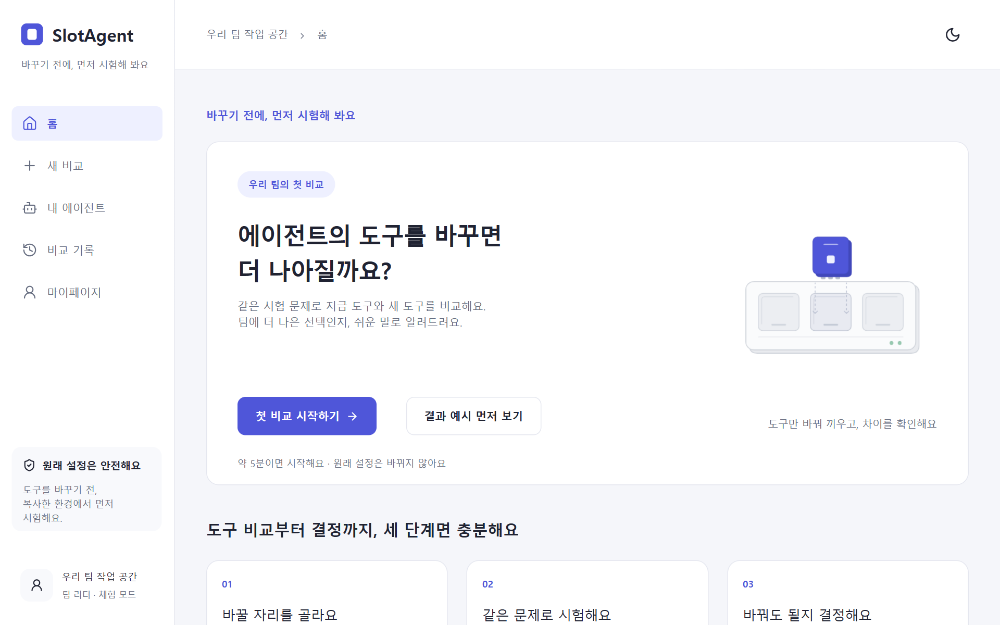
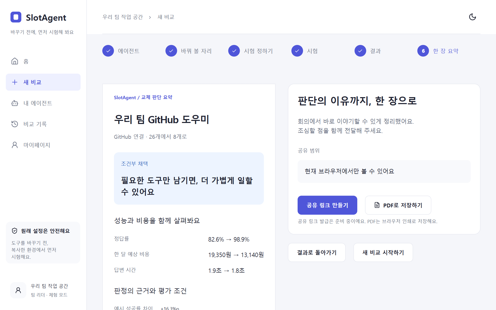
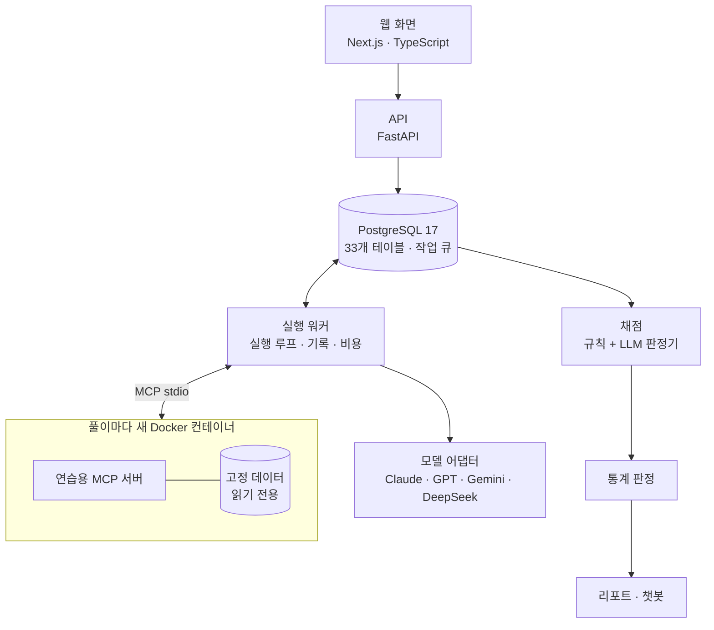

<div align="center">

# SlotAgent

### 바꾸기 전에, 먼저 시험해 봐요

업무용 LLM 에이전트의 **도구를 바꿔 끼웠을 때** 성능·비용·속도가 어떻게 달라지는지<br/>
**같은 문항**으로 비교하고, 그 차이를 **통계로 판정**하는 평가 플랫폼


SK네트웍스 Family AI 캠프 35기 · 최종 프로젝트 4팀

[왜 만들었나](#왜-만들었나) · [사전 실험](#사전-실험-도구만-바꿔도-결과가-달라진다) · [동작 방식](#동작-방식) · [설계 원칙](#핵심-설계-원칙) · [진행 상황](#진행-상황) · [실행 방법](#실행-방법)



<sub>비교 결과 화면 (UI 데모, 사전 실험 기록 재생)</sub>

</div>

## 왜 만들었나

MCP 서버 하나가 도구를 수십 개씩 내놓으면서, 같은 일을 하는 도구가 여럿 생겼습니다. 하지만 지금은 **몇 번 써 보고** 고릅니다.

| 지금의 문제 | SlotAgent의 답 |
|---|---|
| 도구를 고를 정량적 근거가 없다 | 한 자리만 바꾸고 나머지를 고정한 **대응 비교 실험** |
| 최종 답만 보고 평가한다 | 모든 모델·도구 호출을 기록해 **처음 틀린 단계**와 도구별 비용·시간을 분해 |
| 결과를 통계로 해석할 사람이 없다 | 사전 등록한 기준으로 **채택 · 조건부 채택 · 판단 보류 · 기각** 판정 |
| 결과를 결정 근거로 쓰기 어렵다 | 판정·수치·위험·전제를 담은 **한 장 요약서** |

**대상 사용자**: 업무용 에이전트를 직접 만들고 운영하지만 전담 평가 인력이 없는 개발자와 소규모 팀

## 사전 실험: 도구만 바꿔도 결과가 달라진다

본 개발 전에, 같은 에이전트(`gpt-4.1-mini`)에서 **GitHub 도구만** 바꿔 시험했습니다. (2026-11-18)

| 후보 | 정답 | 정답률 | 1회 평균 비용 | 평균 입력 토큰 |
|---|---:|---:|---:|---:|
| A. 직접 만든 도구 1개 | 72 / 92 | 78.3% | 0.69원 | 1,021 |
| B. GitHub MCP를 본뜬 전체 26개 | 76 / 92 | 82.6% | 2.15원 | 3,580 |
| **C. B에서 필요한 8개만** | **91 / 92** | **98.9%** | **1.46원** | **2,335** |

- **필요한 도구만 남긴 C**는 전체를 켠 B보다 정답률이 높고 1회 비용이 **32% 낮았습니다.**
- **A의 실패 20건 중 18건은 도구 범위 밖**이었습니다. 합계 점수만 보면 놓치는 내용입니다.
- **도구의 작은 설계가 결과를 바꿉니다.** 사람 이름을 부분 일치로 찾게 한 수정 하나가, 이 수정이 겨냥한 12문항의 정답률을 **+81.9%p** 올렸습니다. (세 후보 합계, 95% 구간 +66.7 ~ +94.4)

<details>
<summary><b>실험 조건과 한계</b></summary>

- 문항 유형 11개 · 문항 46개 · 2회 반복 = 후보당 92회. 수정 효과를 따로 재려고 6개 설정으로 총 1,656회 실행했고, 위 표는 수정을 모두 켠 설정의 결과입니다.
- 가설·겨냥 문항·판정 규칙은 **실행 전에** 문서로 고정했습니다.
- 실제 GitHub가 아닌 **연습용 데이터**이고 모델은 1종입니다. 환율과 단가는 가정값입니다.
- 위 표의 후보 차이는 관찰값입니다. +81.9%p의 구간은 문항 단위 부트스트랩이며, 문항 유형까지 묶으면 구간이 더 넓어질 수 있습니다.
- 제품 엔진이 아닌 별도 실험 코드로 얻은 결과입니다.

처음에는 같은 문항의 반복을 독립으로 세어 p값이 과장됐고, 문항 단위로 다시 계산하니 "확실한 차이" 일부가 **판단 보류**로 바뀌었습니다. 이 경험이 아래 통계 설계의 출발점입니다.

</details>

## 동작 방식

아래는 전체 설계입니다. 구현된 범위는 [진행 상황](#진행-상황)에 정리했습니다.



| 판정 | 조건 (차이 = 후보 − 기준, 95% 신뢰구간) |
|---|---|
| **채택** | 신뢰구간 하한이 0보다 위 |
| **조건부 채택** | 하한이 −5%p보다 위 + 미리 정한 비용·속도 지표 개선 + 회귀율 한도 이내 |
| **판단 보류** | 어디에도 해당하지 않거나 예산 소진 → 더 필요한 문항 수와 비용을 안내 |
| **기각** | 금지 행동 1건 이상, 또는 구간 전체가 0보다 아래이면서 비열등도 입증하지 못함 |

<sub>판정은 기각 → 채택 → 조건부 채택 → 판단 보류 순서로 적용합니다.</sub>

### 화면

| 바꿔 볼 후보 고르기 | 시험 계획과 예산 |
|:---:|:---:|
|  |  |
| **홈** | **한 장 요약** |
|  |  |

## 시스템 구조



| 영역 | 기술 |
|---|---|
| 프런트엔드 | Next.js 16, React 19, TypeScript, Tailwind CSS 4, Playwright |
| 백엔드 | Python 3.12, FastAPI, psycopg 3, uv |
| 데이터 | PostgreSQL 17 (pgvector 이미지), DB 작업 큐, JSON Schema 계약 |
| 실행·격리 | 자체 실행 루프, MCP stdio, Docker |
| 통계 | NumPy, SciPy, statsmodels |
| 모델 학습·서빙 (예정) | LoRA, TRL, vLLM |

## 핵심 설계 원칙

**1. 공정한 비교** — 모델·프롬프트·나머지 도구·데이터 버전을 고정하고 한 자리만 바꿉니다. 모든 후보가 같은 문항을 같은 횟수로 풉니다.

**2. 결과를 보기 전에 기준을 잠근다** — 1차 지표, 비열등성 마진(기본 5%p), 유의수준(기본 0.05), 예산을 사전 등록합니다. 나중에 바꾸면 "탐색적 결과"로 표시합니다.

**3. LLM 채점은 최소로** — 규칙으로 검사할 수 있는 것은 규칙이 판정하고, 못 보는 항목만 LLM 판정기를 씁니다. 통계 판정에는 LLM을 쓰지 않습니다.

**4. 표본을 부풀리지 않는다** — 반복 풀이를 독립 표본으로 세지 않고, 문항과 문항 유형을 묶음으로 다룹니다. 구별할 수 없는 차이는 "판단 보류"라고 말합니다.

**5. 안전한 실행** — 도구는 풀이마다 새 컨테이너에서 돌고 API 키는 컨테이너에 넣지 않습니다. 쓰기 도구는 외부 시스템에 직접 쓰지 않습니다.

**6. 평가 방법도 평가한다** — 채점 정확도(E1), 근소 차이 판별(E2), 같은 구성 비교(E3), 고장 탐지(E4), 재현성(E5), 채점기 편향(E6)을 통과 기준과 함께 검증할 계획입니다.

## 진행 상황

> 2026-11-25 기준 · 8주 계획에서 **실행 엔진과 IT 운영 평가팩을 먼저** 만들고 있습니다. 평가팩 상세는 [50유형 표](packs/README.md)와 [전체 문항 목록](packs/QUESTIONS.md)을 봅니다.

| 영역 | 상태 | 내용 |
|---|:---:|---|
| DB · 데이터 계약 | ✅ | 테이블 33개, JSON Schema 18개, 역할 간 전달 테스트 |
| 실행 엔진 | 🔄 | 작업 큐 임대·복구, MCP stdio·Docker 격리, 승인·가짜 쓰기·결과/상태 조회 / test_space·dry_run·채점 전체 흐름 통합 남음 |
| 모델 어댑터 | 🔄 | 4개 회사 어댑터와 모의 응답 테스트 / 실제 API 확인 남음 |
| IT 운영 평가팩 | 🔄 | 문항 유형 **50개** · 문항 **152개** · 골든 궤적 **200개** (모두 dev) / 독립 검수·held 분리·파일럿 실측 남음 |
| 규칙 채점기 | 🔄 | 6종 조건(exact_writes 포함), 승인 재검증·200골든 규칙 함수 대조 일치 / 반복 조회 정책·채점 파이프라인 연결 남음 |
| 오답 위험 예측 | 🔄 | 11/18 사전 실험 기록 전처리·3개 모델 교차검증·LightGBM 선정·최종 평가 1회 완료 / 오답50·정답50 사람 검수 남음. [결과서](backend/ml_failure_risk/reports/학습결과서.md). 채택·기각 판정에는 사용하지 않음 |
| 웹 화면 | 🔄 | 전체 흐름 UI 데모 / 실제 API 연결 남음 |
| 통계 판정 · LLM 판정기 | ⏳ | 설계·계약 완료, 구현 예정 |
| 에이전트 등록 · API · 챗봇 · 러너 | ⏳ | 설계·계약 완료, 구현 예정 |
| 추천 오케스트레이터 · 도구 검색 · MCP 서버 | ⏳ | 고도화 단계 |

<sub>✅ 완료 · 🔄 진행 중 · ⏳ 예정</sub>

**자동 테스트: 958 passed** (2026-11-25, Windows, 로컬 DB opt-in 포함). 작업 큐 경합, 강제 종료 후 복구, 컨테이너 격리, 비용 중복 방지, 규칙 채점, 평가팩 저장 후 롤백을 확인했습니다. 제품 규칙 함수 대조는 200골든 일치·판정 불가0개, 개발 시뮬레이션은 882건 기대 결과 일치입니다. 이 결과는 전체 채점 파이프라인·독립 사람 검수 완료를 뜻하지 않습니다. 실제 모델 API 호출과 Linux 호스트의 실제 Docker는 아직 검증 범위에 없습니다.

## 실행 방법

### 화면 데모

Node.js 20.9 이상이 필요합니다. 백엔드나 API 키 없이 볼 수 있습니다.

```bash
cd frontend
npm ci
npm run dev
```

브라우저에서 <http://127.0.0.1:3000> 을 엽니다.

### 백엔드 테스트

Python 3.12와 [uv](https://docs.astral.sh/uv/)가 필요합니다. 테스트용 PostgreSQL은 임시로 실행됩니다. 일부 격리 테스트에는 Docker가 필요합니다.

```bash
cd backend
uv sync
uv run pytest
```

### 로컬 개발 DB

저장소 루트에서 실행합니다. 새 볼륨을 처음 만들 때 마이그레이션이 자동 적용됩니다.

```powershell
Copy-Item .env.example .env
docker compose up -d
```

## 저장소 구조

```text
├─ frontend/        웹 화면 (Next.js)
├─ backend/
│  ├─ src/slotagent/
│  │  ├─ engine/    실험 잠금 · 실행 루프 · MCP · Docker · 비용
│  │  ├─ grading/   규칙 채점 · LLM 판정
│  │  ├─ packs/     평가팩 적재 · 문항 선택
│  │  ├─ stats/     통계 판정
│  │  ├─ intake/    에이전트 · 후보 등록
│  │  └─ common/    DB · 작업 큐 · 모델 어댑터 · 계약 검사
│  ├─ db/           마이그레이션 · 시드 · 연습 DB
│  └─ tests/
├─ contracts/       역할 사이 데이터 계약 (JSON Schema)
├─ packs/           IT 운영 평가팩 (문항 · 정답 · 골든 궤적)
├─ runner/          고객 환경 러너 (예정)
├─ serving/         모델 서빙 (예정)
└─ docs/            결정 기록 · 설계 문서
```

| 더 보기 | |
|---|---|
| [데이터 계약](contracts/README.md) | 역할 사이에 오가는 JSON과 예시 |
| [DB 설계와 이름 규칙](backend/db/README.md) | 테이블·제약·마이그레이션 |
| [평가팩 안내](packs/README.md) · [전체 문항](packs/QUESTIONS.md) | 문항 구성과 검증 상태 |
| [화면 안내](frontend/README.md) | UI 데모의 구현 범위 |
| [팀 결정 기록](docs/decisions_pending.md) | 정한 것과 남은 것 |

## 팀

역할 사이는 **DB 테이블과 `contracts/` 스키마로만** 연결해, 네 명이 독립적으로 개발하고 합칠 수 있게 했습니다.

| 역할 | 담당 | 맡은 일 |
|---|---|---|
| ① 실행 엔진 | 고태민 | 잠금·실행·격리·기록, 규칙 채점, API, 고도화 |
| ② 평가팩 · 판정기 | 박민하 | 문항·정답·골든 궤적, LLM 판정기 |
| ③ 통계 · 리포트 | 조현주 | 신뢰구간·판정·검증 실험, 리포트 |
| ④ 등록 · 챗봇 | 고은하 | 에이전트 연결, 비용, 러너, 챗봇 |
