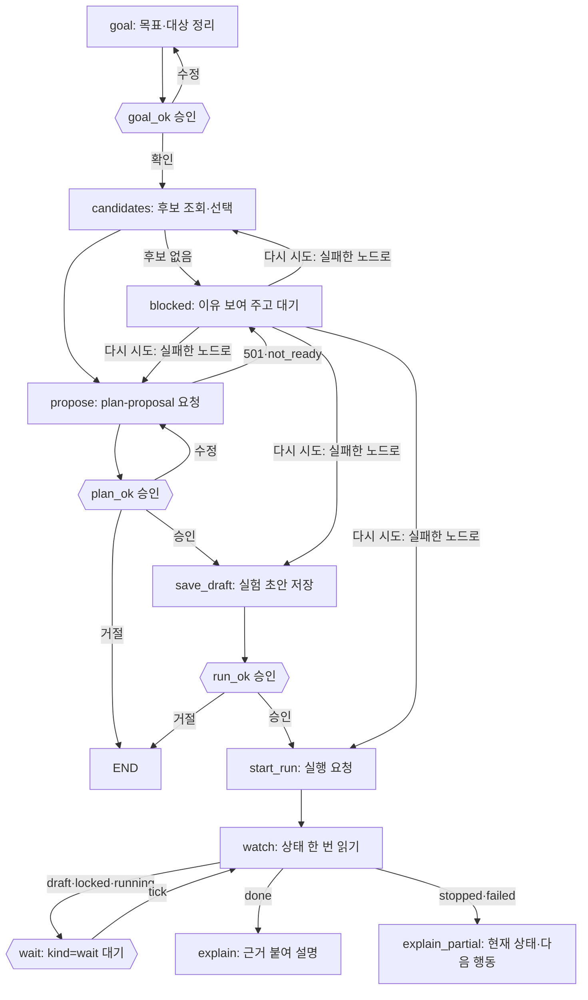

# 오케스트레이터 1차 설계 (① · 11/27)

범위: 체크리스트 W6~W8 "오케스트레이터 (후보 찾기 → 설계 → 승인 → 감시 → 추천)". GEPA 는 이 흐름이 끝난 뒤에 붙입니다.
원칙: 오케스트레이터는 실험 **절차만** 관리합니다. 표본 수·채점·통계 판정·실험 상태 변경은 기존 코드가 하고, 오케스트레이터는 API 로 요청만 합니다 (AGENTS 3 "고도화").

## 0. 고정 시나리오

> "이 GitHub 에이전트의 비용을 줄이고 싶어. 정확도가 얼마나 달라지는지 비교해줘."

| 단계 | 하는 일 | 판단 주체 |
|---|---|---|
| 목표 정리 | 대상(에이전트 버전·자리)과 관심 축(비용·정확도·속도)을 구조화 | LLM 초안 → 사용자 확인 |
| 후보 찾기 | 같은 자리·`PHASE1_KINDS`·같은 MCP 서버 조건에 맞는 **등록된** 후보만 조회 | 코드가 거름, LLM 은 그 안에서 최대 2개를 고르고 이유 설명 (정수 ID 만, 목록 밖은 버림) |
| 실험 설계 | `POST /api/experiments/plan-proposal` | 기존 계산 (`common.proposal.propose`) |
| 승인 ×2 | ① 계획·저장 ② 실행 시작 (MCP 서버의 `create_experiment`·`start_run` 구분과 같음) | 실제 사용자 |
| 실행·감시 | `POST /{id}/run`, `GET /{id}/status` | 기존 API·워커 |
| 결과 설명 | 최종 분석 + 리포트 2종을 근거로 설명 | ③ 판정 + LLM 설명 |

- 판정 지표는 계약상 `prereg.primary_metric = success_rate` 고정입니다. "비용을 줄이고 싶다"는 목표는 **후보를 고르는 기준과 설명의 초점**에만 쓰고, 판정 방식은 바꾸지 않습니다. 기본 검정 `ni_then_sup`(비열등성 먼저)가 이 질문("정확도가 떨어지지 않는가")에 맞습니다.
- 여기서 말하는 승인은 실제 사용자의 승인입니다. 문항 안의 가짜 사용자 확인(P-05)과는 다릅니다.
- 후보가 없거나 필요한 기능이 아직 없으면(`501`, `not_ready`) 그 지점에서 이유를 보여 주고 멈춥니다. 임의의 후보나 계산값으로 다음 단계에 넘어가지 않습니다.

## 1. 그래프



`blocked` 의 다시 시도는 `last_error.node` 로 돌아갑니다 (후보 없음 → `candidates`, `501` → `propose`, 저장 실패 → `save_draft`, 실행 실패 → `start_run`). `experiment_id` 가 이미 있으면 그 앞(`candidates`·`propose`)으로는 돌아가지 않습니다 — 저장된 실험 문맥을 다시 시작하지 않기 위해서입니다.

`{{ }}` = `interrupt()` 만 하는 노드 (승인 노드와 `wait`). **승인 노드에는 부수 효과를 두지 않습니다.** `interrupt()` 로 멈췄다가 재개하면 그 노드가 처음부터 다시 실행되기 때문입니다.

## 2. 상태 (체크포인트에 저장하는 것)

실험의 실제 상태·수치는 DB(`sa_*`)가 원본입니다. 체크포인트에는 아래 정도만 둡니다. 실행 기록(`sa_spans`)은 풀이별 모델·도구 호출 기록이라 여기 쓰지 않습니다.

```python
class OrchState(TypedDict):
    # 대상
    user_id: int
    agent_version_id: int | None
    slot_id: int | None
    pack_version_id: int | None
    goal: dict | None              # {"focus": ["cost","accuracy"], "text": 원문}  LLM 초안 → 확인본
    candidate_ids: list[int]       # 기준 후보 포함. 코드가 거른 목록 안에서만
    # 계획
    proposal: dict | None          # plan-proposal 응답 그대로 (prereg·plan·as_of 등). 출처 해시는 이 안의 proposal_hash
    create_request: dict | None    # 보낼 create_experiment_request 전체 (대상 ID·후보·reps·budget_krw·prereg·plan·proposal)
    approval_hash: str | None      # canonical_hash(create_request) — 승인 비교용 (4절)
    proposed_at: str | None
    # 승인: 행동마다 하나. 내용 해시가 지금 요청과 다르면 무효
    approvals: dict[str, dict]     # {"save_draft": {"by", "at", "hash": approval_hash}, "start_run": {"by", "at", "hash": run_hash}}
    # 진행
    step: str                      # 마지막으로 끝낸 노드
    experiment_id: int | None
    create_key: str | None         # 초안 저장 중복 방지 키 (5절)
    last_error: dict | None        # {"node":..., "code":..., "detail":...}
    # 근거
    analysis_id: int | None        # 최종 분석 (4절의 final_analysis_id)
    report_ids: list[int]
```

- `thread_id` = 오케스트레이션 하나 (사용자의 비교 요청 하나). 재개는 같은 `thread_id` 로.
- 체크포인트 저장: `langgraph-checkpoint-postgres` 의 `PostgresSaver`, 스키마 `orchestrator` (`search_path=orchestrator` 로 접속, sa_ 이름 규칙 밖). `setup()` 은 이 스키마에만 테이블을 만듭니다.
- 모델 호출: `common/llm.py` 의 `ChatModel` 만 씁니다. 시험은 `FakeModel`.

## 3. 노드별 입력·출력

| 노드 | 읽는 것 | 하는 일 | 바꾸는 상태 | 부수 효과 |
|---|---|---|---|---|
| `goal` | 사용자 말 | LLM 이 `goal`·대상 초안 작성 (`agent_version_id`·`slot_id` 는 DB 에 있는 값 중에서만) | `goal`, 대상 | 없음 |
| `goal_ok` | `goal` | `interrupt({"kind":"goal","goal":...})` → 확인(`by` 필수)/수정/거절 | `goal`, `approvals.goal` | 없음 |
| `candidates` | 대상 | 같은 `slot_id`·`PHASE1_KINDS`·같은 MCP 서버 후보를 **코드로** 조회 → LLM 이 그 안에서 비교 후보 최대 2개 + 이유 (기준 1개는 코드가 붙임) | `candidate_ids` | 없음 (읽기) |
| `propose` | 대상·후보 | `POST plan-proposal` → `create_request` 조립 | `proposal`, `create_request`, `approval_hash`, `proposed_at` | 없음 (저장 안 하는 API) |
| `plan_ok` | `create_request` | 후보·문항 수·반복 수·예산을 보여 주고 `interrupt`. 예상 비용은 `propose()` 가 돌려주지 않으므로 계산 연결부가 없으면 **"산정 전"** 으로 표시 | 승인이면 `approvals.save_draft`, 수정이면 요청값(`reps`·`budget_krw`·후보) | 없음 |
| `save_draft` | `create_request`, 승인 | 승인의 `hash` == 지금 `approval_hash` 확인 → `POST /api/experiments` (`create_key` 포함) | `experiment_id` | **DB 쓰기** |
| `run_ok` | `experiment_id` | `GET status` 로 풀이 수·예산을 다시 읽어 보여 주고 `interrupt` | `approvals.start_run` | 없음 |
| `start_run` | 승인 | 승인 확인 → `POST /{id}/run`. `experiment_locked` 면 오류로 끝내지 않고 `status` 를 다시 읽어 `watch` 로 (5절) | — | **DB 쓰기** (draft·locked·running 은 멱등) |
| `watch` | `experiment_id` | `GET status` 한 번 읽고 상태에 따라 `wait`·`explain`·`explain_partial` 로 | `last_error` | 없음 |
| `wait` | `experiment_id` | `interrupt({"kind":"wait",...})` 만. `tick` 으로 재개되면 `watch` 로 (4절 "감시 주기") | — | 없음 |
| `explain` | `experiment_id` | 4절 조건 확인 → 분석·리포트 읽기 → LLM 설명(숫자 없는 글) → `prose_problems` 통과해야 저장. 저장 모양 `{facts: 저장값 그대로, text: 글}` | `analysis_id`, `report_ids`, `explanation` | 없음 |
| `explain_partial` | status | **모델 없이** 정해진 글 + `facts` = status 응답 그대로. 추천하지 않음 | `explanation` | 없음 |
| `blocked` | `last_error` | 이유 보여 주고 `interrupt` (다시 시도 / 거절) | — | 없음 |

LLM 이 쓰는 곳은 `goal`·`candidates`(이유)·`explain` 셋뿐입니다. 숫자·판정·근거 ID 는 LLM 이 쓰지 않고 `explanation.facts` 에 저장값 그대로 둡니다.

- 설명 글에는 숫자 글자를 쓰지 않게 합니다 (`brain.prose_problems`: 유니코드 숫자 값을 가진 글자 — 아라비아·전각·분수·첨자·원 문자·로마(Ⅰ~)·한자 수 — 와 %·퍼센트가 있으면 저장하지 않고 `blocked(explanation_rejected)`). **말로 쓴 수량("절반", "두 배", "twice", 한글 수사)과 ASCII 로마 숫자(XII)는 막지 않습니다** — 단어 목록으로는 끝이 없고, 프로세스·CLI·CI·LLM 같은 정상 용어까지 막기 때문입니다. 따라서 글에 수치가 없다고 보증하지 않습니다. 숫자·판정의 원본은 `facts` 이고, 화면은 `facts` 를 먼저 보여 주고 `text` 에는 "모델 설명" 출처를 붙여야 합니다 (`text` 에서 수치·판정을 뽑아 쓰지 않음). 판정과 반대되는 글도 같은 이유로 코드가 막지 못합니다.
- `explain_partial` 은 모델을 부르지 않습니다 (추천이 섞일 길을 없앰).
- 사용자 응답은 `runtime.resume` 으로만 넣습니다. dict 아님·JSON 값 아님(NaN·Infinity 포함)·bigint 범위 밖·32단계보다 깊음(순환 포함)이면 그래프에 넣지 않고 `ValueError("invalid_answer")` (넣으면 체크포인트에 먼저 저장돼 같은 오류가 반복됨). 계획 수정값은 `plan_proposal_request` 계약으로 검사해 어기면 `edit_error`.
- 승인 응답은 `approve`·`edit`·`reject`(blocked 는 `retry`·`reject`)만. 그 밖의 값(오타·빈 응답)은 끝내지 않고 같은 대기로 돌아갑니다. 명시적 `reject` 만 끝냅니다.
- 모델이 글이 아닌 값을 돌려주면 `ModelError("bad_reply")` → blocked. 네트워크 같은 일반 예외는 실제 HTTP 연결부가 `BackendError` 로 바꿔야 합니다 (4단계).

## 4. 상태 전이 규칙

**승인**
- 승인 비교에는 `common.proposal.proposal_hash` 를 쓰지 않습니다. 그 해시는 `{prereg, plan}` 만 보므로 후보·반복 수·예산·대상 ID 를 바꿔도 같습니다. 출처 기록용으로 그대로 두고, 승인에는 **실제로 보낼 요청 전체**의 해시를 씁니다.
  - 저장 승인: `approval_hash = canonical_hash(create_request)` — `create_experiment_request` 의 모든 칸 (`agent_version_id`·`slot_id`·`pack_version_id`·`reps`·`budget_krw`·`candidates`·`prereg`·`plan`·`proposal`).
  - 실행 승인: `run_hash = canonical_hash({"experiment_id": ..., "approval_hash": ...})`.
- 계획이 바뀌면 기존 승인을 다시 받습니다. `save_draft`·`start_run` 노드는 실행 전에 `approvals[행동].hash` 가 지금 값과 같은지 확인하고, 다르면 승인 노드로 돌아갑니다. 요청값을 하나라도 고치면 `approval_hash` 가 바뀌어 기존 승인은 자동으로 무효가 됩니다.
- 승인 기록에는 누가(`user_id`), 언제, 어떤 행동, 어떤 내용(해시)을 승인했는지 남깁니다.
- 승인 응답은 `Command(resume={"action":"approve"|"edit"|"reject", "by": user_id, ...})` 로만 받습니다. LLM 이 대신 승인하지 않습니다.

**감시 → 설명 (H→I)**
- `status == "done"` 일 때만 `explain` 으로 갑니다. `done` 은 종료 게이트(`engine/advance.completion_blockers`)가 미완료·취소 풀이 없음, 전체를 채점한 최종 분석, 그 분석의 `one_pager`·`detail` 리포트를 확인한 뒤에만 됩니다.
- 근거 분석은 status 의 `latest_analysis_id` 를 쓰지 않습니다. 이 값은 `max(analysis_id)` 라 중간 분석일 수 있습니다.
- 근거 분석은 `final_analysis_id(conn, experiment_id)` 하나로 고릅니다 (① 엔진 파일, 계약 변경 없음. HTTP 로 읽을 길은 7절). 조건은 **둘 다**:
  1. 게이트의 전체 채점 조건 (중간 분석 아님, 채점 끝남, 마지막 묶음까지, 유효 풀이가 빠짐없이 채점됨)
  2. 그 분석에 `one_pager`·`detail` 리포트가 모두 있음
  - 여러 개면 `analysis_id` 가 가장 큰 것. 없으면 `None`.
  - `None` 하나로는 게이트의 `analysis_missing`(조건 1 을 채운 분석이 없음)과 `reports_missing`(있지만 리포트가 모자람)을 가를 수 없습니다. 그래서 조건 1 만 보는 보조 조회 `complete_analysis_ids(conn, experiment_id)` 를 두고, `final_analysis_id` 는 그 목록 중 리포트 2종이 있는 가장 큰 ID 를 고릅니다. 게이트는 목록이 비면 `analysis_missing`, 목록은 있는데 `final_analysis_id` 가 `None` 이면 `reports_missing` — 지금 오류 구분 그대로입니다.
  - 분석 조회만 떼어 내면 안 됩니다. 지금 게이트는 조건에 맞는 분석 **중 하나**에 리포트가 있으면 통과하므로, 리포트가 있는 A 와 더 최신이지만 리포트가 없는 B 가 있을 때 B 를 고르면 같은 문제가 생깁니다.
  - 게이트(`completion_blockers`)도 이 함수를 써서 `analysis_missing`·`reports_missing` 을 정하게 바꿉니다. 그러면 "done 인데 설명할 분석이 없음" 이 생기지 않습니다. 기존 게이트 시험이 그대로 통과해야 합니다.
- 풀이가 전부 끝났어도 `done` 이 아니면(분석·리포트 대기) `watch` 에 남습니다.
- `stopped`·`failed` → `explain_partial`. 추천은 하지 않습니다. 중간 분석이 있으면 "중간 결과" 로만 보여 줍니다.

**감시 주기**
- 그래프 안에서 `watch` 가 자기 자신으로 도는 방식은 쓰지 않습니다. LangGraph 기본 `recursion_limit` 은 25 라 긴 실험에서 한도에 걸리고, 조회마다 체크포인트도 쌓입니다.
- 첫 버전부터 **`watch → wait(interrupt) → tick → watch`** 구조입니다. `watch` 는 status 를 **한 번** 읽고, 진행 중이면 `wait` 로 갑니다. `wait` 는 `interrupt({"kind":"wait","experiment_id":...})` 만 합니다. `tick` 으로 재개되면 `interrupt()` 가 값을 돌려주고 `wait` 는 `watch` 로 갑니다. 한 번 재개할 때 지나는 노드는 `wait → watch → wait` 정도라 한도와 무관합니다.
- **외부 구동기**는 정해진 간격마다 대기 중인 `thread_id` 를 `Command(resume={"action":"tick"})` 로 재개합니다. 이때 **대기 값의 `kind == "wait"` 인 스레드만** 깨웁니다. 승인 대기(`goal`·`plan`·`run`)나 `blocked` 는 `tick` 으로 재개하지 않습니다. 반대로 `wait` 는 `tick` 이 아닌 재개 값(승인 등)을 받으면 무시하고 다시 `wait` 로 갑니다.
- 구동기는 상태를 갖지 않습니다. 대기 중인 스레드와 그 `kind` 는 체크포인트에서 읽습니다. 재시작하면 마지막 체크포인트의 `wait` 대기부터 다시 시작합니다.

## 5. 중복 요청 처리

체크포인트는 "노드가 끝난 뒤" 저장됩니다. 노드 안에서 요청을 보내고 응답을 받은 다음, 체크포인트를 쓰기 전에 죽으면 재시작 때 그 노드가 다시 실행됩니다. 그래서 **체크포인트만으로는 중복이 막히지 않고, 받는 쪽 요청 자체가 멱등이어야** 합니다.

| 요청 | 지금 | 오케스트레이터가 할 일 |
|---|---|---|
| `plan-proposal` | 저장 안 함 | 다시 불러도 무해 |
| 실행 `POST /{id}/run` | draft·locked·running 은 멱등 — `lock_and_enqueue` 는 draft 일 때만 작업을 넣고, locked·running 이면 지금 상태만 돌려줌. **끝난 실험(done·stopped·failed)이면 `experiment_locked` 오류** | 아래 |
| 초안 저장 `POST /api/experiments` | **중복 방지 없음** — `create_experiment_request` 에 키 칸이 없고 ④ `create_experiment_draft` 는 미구현 | 아래 |

실행 재요청:
- 실행 요청 성공 → 체크포인트 저장 전 종료 → 그사이 실험 완료 → 오케스트레이터 재시작이면 재요청이 `experiment_locked` 를 받습니다.
- `start_run` 은 `experiment_locked` 를 받으면 `GET status` 를 다시 읽고 `watch` 로 넘깁니다. `watch` 가 `done` 이면 `explain`, `stopped`·`failed` 면 `explain_partial` 로 보냅니다. 다른 오류만 `blocked`.
- 실행 승인(`approvals.start_run`)이 없으면 이 복구 경로도 타지 않습니다 — 승인 없이 실행된 실험을 설명으로 넘기지 않기 위해서입니다.

초안 저장:
- `create_key = f"{thread_id}:{approval_hash}"` 를 승인 시점에 상태에 넣고, 저장 요청에 같이 보냅니다. 요청값이 바뀌면 키도 바뀝니다. 받는 쪽이 같은 키면 기존 `experiment_id` 를 돌려주는 모양을 **제안**합니다 (계약 변경 → ④와 4명 확인, 7절).
- 그 전까지는 가짜 연결부가 이 동작을 흉내 냅니다. 가짜 시험은 **그래프가 키를 같게 보내는지**만 확인합니다. 실제 저장 API 의 중복 방지는 ④ 구현 뒤 그 API 시험으로 따로 확인해야 하고, 가짜 시험으로 검증됐다고 보지 않습니다.
- 저장 전에 "같은 제안으로 만든 draft 가 있는지" 조회해서 피하는 방법은 쓰지 않습니다. 동시에 두 번 오면 둘 다 통과합니다.

## 6. 연결부 (교체 가능하게)

그래프는 아래 `Protocol` 하나만 압니다. 구현은 **HTTP 클라이언트**(실제 API)와 **가짜**(시험) 두 개. 그래프 안에서 DB 를 직접 쓰거나 ④의 저장을 대신 구현하지 않습니다.

```python
class Backend(Protocol):
    def list_candidates(self, slot_id: int) -> list[dict]: ...        # 코드가 거른 목록
    def plan_proposal(self, req: dict) -> dict: ...                   # plan_proposal_request → response
    def create_experiment(self, req: dict, create_key: str) -> int: ...
    def run(self, experiment_id: int) -> dict: ...
    def status(self, experiment_id: int) -> dict: ...
    def final_result(self, experiment_id: int) -> dict: ...           # 최종 분석 + 리포트 2종
```

| 연결부 | 지금 상태 | 1차 구현 |
|---|---|---|
| `list_candidates` | 후보 목록 API 없음 | 가짜. `HttpBackend` 는 not_ready |
| `plan_proposal` | API 있음, ③ `sample_size` 없으면 `501` | 그래프 시험은 가짜, `HttpBackend` 는 실제 HTTP |
| `create_experiment` | `POST /api/experiments` 있음(11/27), **중복 방지 키 없음** | 가짜 (키 멱등). `HttpBackend` 는 키 계약 전까지 not_ready — 재시작 때 실험이 둘 생길 수 있어 쓰지 않음 |
| `run`·`status` | **있음** | 실제 HTTP (`orchestrator/http.py`, `tests/test_eng_orch_http.py`) |
| `final_result` | `engine/advance.final_analysis_id` 있음(11/27), **HTTP 로 읽는 길 없음**(7절 2) | 가짜. `HttpBackend` 는 not_ready → 읽는 길을 정한 뒤 실제 |

시험은 두 갈래로 나눕니다. 가짜 저장이 돌려준 ID 는 실제 DB 에 없으므로 둘을 섞지 않습니다.

| 시험 | Backend | 가짜 상태가 있는 곳 | 보는 것 |
|---|---|---|---|
| 그래프 재생성 | **전부 가짜** | 시험 프로세스 메모리 (같은 가짜 객체를 계속 씀) | 전이, 재승인, `experiment_locked` 복구, 그래프 객체·체크포인터만 다시 만든 뒤 이어짐 |
| 프로세스 종료 | **전부 가짜** | **`pgserver` 임시 DB 의 시험용 표** (만든 실험·받은 `create_key`·실행 요청 횟수) | 오케스트레이터를 하위 프로세스로 띄워 저장·실행 노드 도중 강제 종료 → 새 프로세스가 같은 체크포인트·같은 가짜 DB 로 재개 → 실험 1개·실행 1회 |
| 실제 연결 | `run`·`status`(·`final_result`) 만 실제 HTTP | fixture 가 `pgserver` 임시 DB 에 직접 만든 draft 실험 | 응답 모양, 실행 재요청 멱등, 끝난 실험 재요청 → 복구 |

- 메모리 가짜로는 프로세스 종료를 검증할 수 없습니다. 프로세스가 끝나면 키와 실험 기록이 같이 사라져 "중복이 안 생겼다" 를 셀 수 없기 때문입니다. 그래서 프로세스 종료 시험의 가짜 Backend 는 상태를 임시 DB 에 둡니다. 이 표는 시험 fixture 가 만들고 지우며, 마이그레이션·`sa_` 이름 규칙 밖입니다.
- 그래프 재생성 시험은 빠르게 많이 돌리고, 프로세스 종료 시험은 첫 완료 기준의 핵심 경로 몇 개만 돌립니다.

## 7. 미정 · 다른 역할과 정할 것

1. **초안 저장 중복 방지 키** — `create_experiment_request` 에 `idempotency_key`(가칭) 추가. 계약 변경, ④·4명 확인.
2. **최종 결과 읽기 경로** — `final_analysis_id` 를 HTTP 로 어떻게 노출할지 (status 응답에 칸 추가는 계약 변경 / MCP `get_results` 가 최종 분석을 보게 할지).
3. **후보 목록 API** — ④ 등록 쪽 모양에 맞춤.
4. **승인 기록을 DB 에도 남길지** — 지금은 체크포인트에만 둡니다. `sa_chat_messages` 에 남기려면 `function_name` 목록 확장 (새 마이그레이션 0007).
7. **예상 비용** — `propose()` 가 돌려주지 않음. 계산 연결부(③④)가 생기기 전까지 `plan_ok` 는 "산정 전".
5. **`stopped`·`failed` 설명 범위** — 중간 분석을 보여만 줄지, 아예 숨길지.
6. **오케스트레이터가 `prereg` 를 고칠 수 있는지** — 1차는 고치지 않음 (plan-proposal 값 그대로, 사용자가 고친 요청값만 다시 제안).

## 8. 구현 순서와 첫 완료 기준

1. 상태 정의·노드·전이 (가짜 `Backend`·`FakeModel`)
2. 승인·수정·거절 처리, 계획 변경 시 재승인
3. `PostgresSaver`(스키마 `orchestrator`)와 재시작 복구, `watch` 외부 구동기
4. 실제 `run`·`status` 연결 (fixture 실험)
5. `final_analysis_id`(전체 채점 + 리포트 2종) 분리, 게이트도 이 함수로 → `final_result` 실제 연결
6. ③④ 기능이 들어오면 나머지 가짜를 실제로 교체

**첫 완료 기준** (프로세스 종료 시험: DB 에 상태를 둔 가짜 Backend·가짜 모델, 체크포인트는 `pgserver`):
계획 제시 → `plan_ok` 대기 → 프로세스 강제 종료·새 프로세스로 재개 → 승인 → 초안 1개 → `run_ok` 승인 → 저장·실행 노드 도중 강제 재시작해도 **같은 `create_key`·실험 1개·실행 1회** → 구동기 재개 여러 번 → `done` 뒤 최종 분석 ID 로 설명.
같이 볼 것:
- 후보·반복 수·예산 중 하나만 고쳐도 옛 승인으로는 저장 안 됨
- 실행 요청 성공 뒤 체크포인트 전 종료 → 실험 완료 → 재시작 → `experiment_locked` → `done` 이면 설명, `stopped` 면 부분 설명
- 구동기 재개가 25번을 넘어도 한도 오류 없음
- 구동기는 `kind="wait"` 스레드만 깨움 — 승인 대기 중인 스레드는 `tick` 이 가도 그대로, `wait` 가 승인 값을 받아도 다시 `wait`
- 게이트 오류 구분 유지: 분석 없음 → `analysis_missing`, 분석은 있고 리포트 모자람 → `reports_missing`
- `501` 이면 `blocked`, 다시 시도는 실패한 노드로 (저장 뒤 실패면 후보 찾기로 안 돌아감)
- 풀이가 다 끝나도 `done` 전에는 설명 안 함, 리포트 없는 최신 분석은 근거로 안 고름
